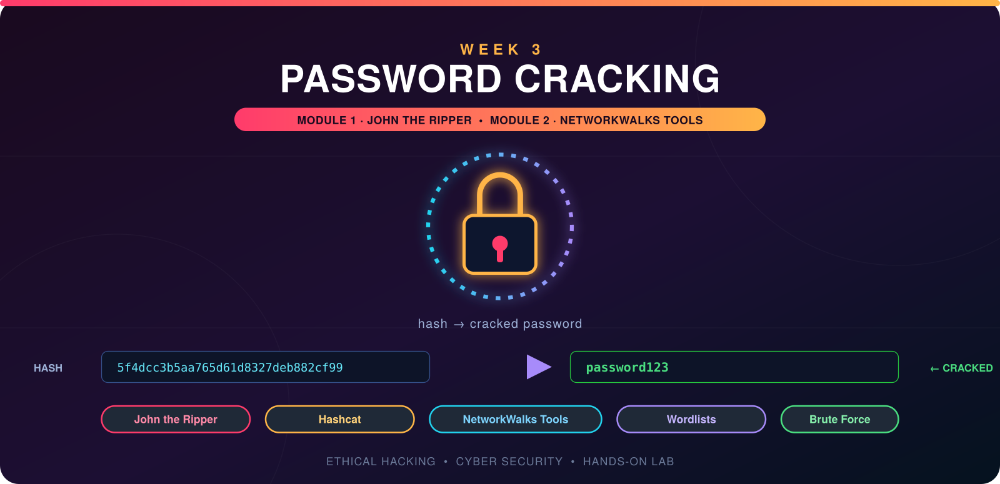
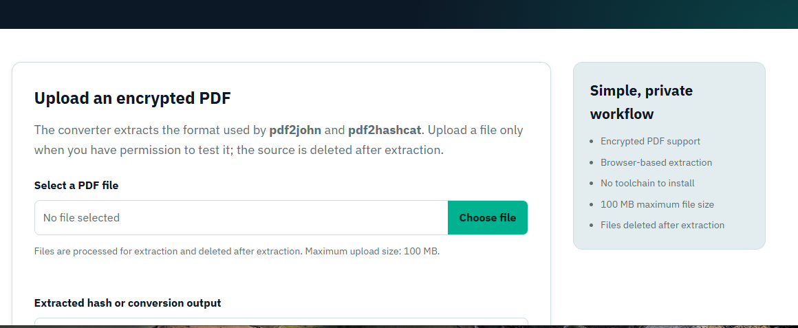
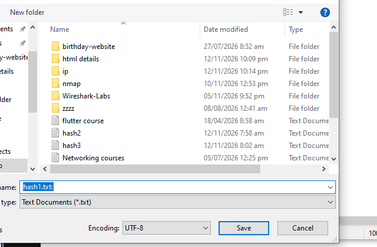
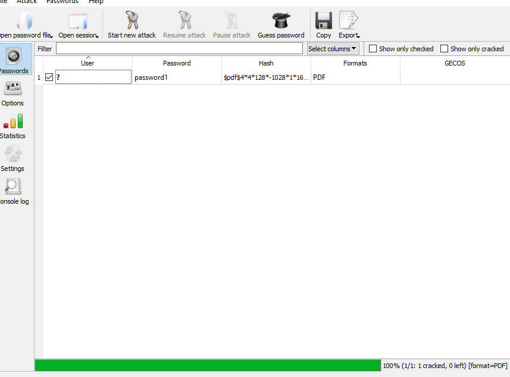
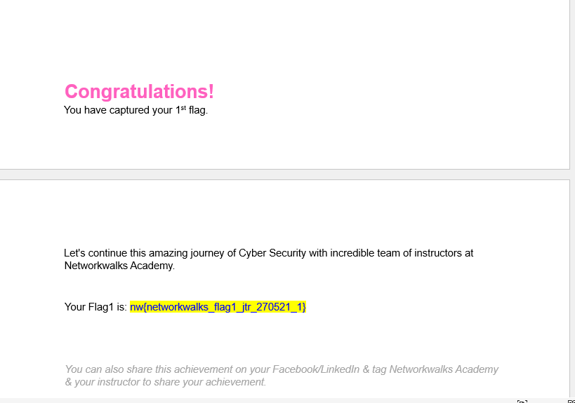
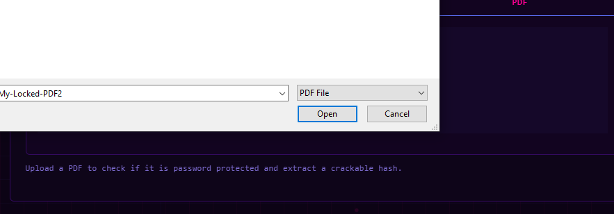
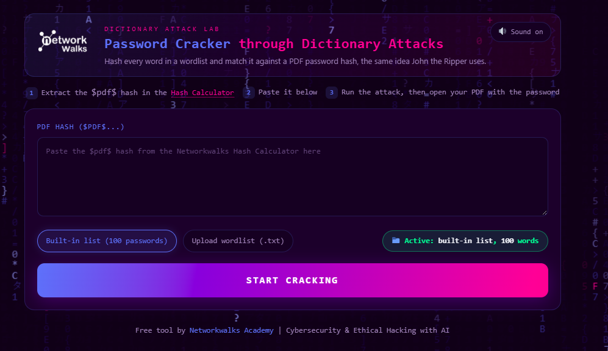

  

<h1 align="center">🔓 WEEK 3 | Password Cracking Techniques</h1>

> [!IMPORTANT]  
> **👨‍💻 Student Intro**
> *   **Student Name:** Muhammad Ayaz
> *   **Program/Batch:** Cyber Security | Batch B084H
> *   **Instructor:** Mr. Waqas Karim (CCIE)
> *   **Institute:** Network Walks

---

# 📌 MODULE 1: Password Cracking with JTR (John The Ripper)

**Task:** Crack the password of an attached PDF file (`My Locked PDF1.pdf`) using **John the Ripper (JTR)** and **Johnny GUI** on a Windows PC.

### ⚙️ Step-by-Step Execution

**Step 1 & 2: Install John the Ripper & Johnny GUI**
Downloaded John the Ripper from the official Openwall website and installed the Johnny GUI. Configured the settings to point to the `john.exe` file located in the `run` folder.

**Step 3: Extract PDF Hash**
Downloaded the encrypted PDF file. Opened the online hash extractor tool (`onlinehashcrack.com`) to extract the hash from the locked PDF.

**Evidence (Hash Extractor Tool):**

**Step 4: Save the Hash**
Copied the extracted PDF hash code, opened **Notepad**, pasted the code, and saved the file as **`hash.txt`**.

**Evidence (Saving hash.txt file):**

**Step 5: Crack the Password in Johnny GUI**
Opened Johnny GUI, loaded the `hash.txt` file, and started the attack. The tool successfully cracked the password, which was displayed as `password1`.

**Evidence (Johnny GUI Password Cracked):**

**Step 6: Open the PDF File**
Used the cracked password (`password1`) to successfully open the first PDF file and captured the flag.

**Evidence (Flag Captured):**

 

---

# 📌 MODULE 2: Password Cracking with Networkwalks Tools

**Task:** Crack the password of the attached PDF file (`My Locked PDF1.pdf`) using the Networkwalks Hash Calculator and Password Cracker tools.

### ⚙️ Step-by-Step Execution

**Step 1 & 2: Extract the Hash**
Opened the Networkwalks Hash Calculator and uploaded the locked PDF file to extract the hash value starting with `$pdf$...`.

**Evidence (Uploading PDF):**

**Evidence (Hash Calculator Tool):**

**Step 3: Prepare the Password Cracker**
Copied the full `$pdf$` hash and opened the Networkwalks Password Cracker in the browser. Pasted the hash into the input field and selected the built-in 100-word list.

**Evidence (Password Cracker Interface):**

**Step 4: Run the Dictionary Attack**
Started the cracking process. The tool tried different passwords from the wordlist. After trying 91 out of 100 words, it successfully found the match.

*   **Cracked Password:** `password1`

**Evidence (Dictionary Attack in Progress & Match Found):**

**Step 5: Capture the Flag**
Used the cracked password to open the PDF and capture the flag using Networkwalks tools.

**Evidence (Flag Captured):**

---

## 🔍 Key Takeaways
*   **JTR vs Online Tools:** John the Ripper provides powerful offline cracking capabilities, while online tools like Networkwalks offer a quick, browser-based alternative for simple dictionary attacks.
*   **Hash Extraction:** Extracting the hash is the most critical step. Once the `$pdf$` hash is extracted, the original file is no longer needed for the cracking process.
*   **Weak Passwords:** The password `password1` is a classic example of a weak, dictionary-based password that can be cracked in seconds.

---

> [!TIP]
> **✅ Week 3 Status: Both Modules Completed**
> Successfully executed Dictionary Attacks using both John the Ripper (JTR) and Networkwalks web tools.
