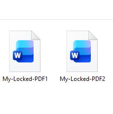
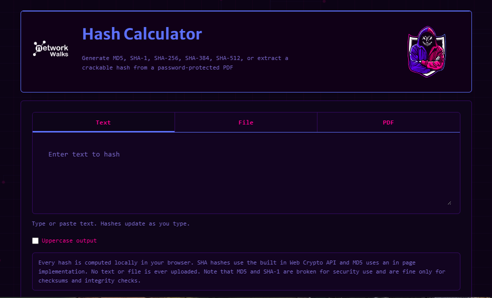
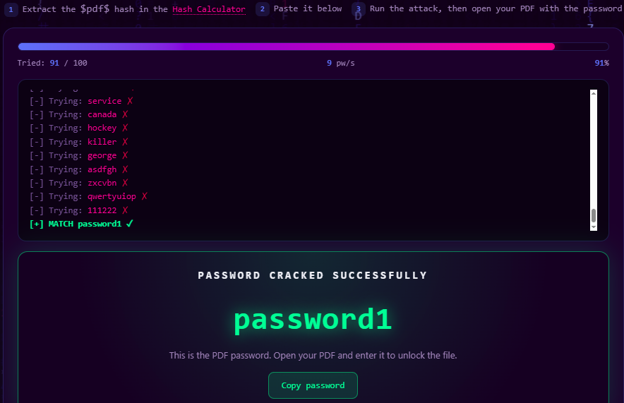

  

<h1 align="center">🔓 WEEK 3 | Password Cracking with Networkwalks Tools</h1>

 

<!-- Colorful Author & Instructor Box -->

  <h3 style="margin-top: 0; color: #ecf0f1; border-bottom: 2px solid rgba(255,255,255,0.2); padding-bottom: 10px;">👨‍💻 Lab Details</h3>
  
<b>Student Name:</b> Muhammad Ayaz

  
<b>Program/Batch:</b> Cyber Security | Batch B084H

  
<b>Instructor:</b> Mr. Waqas Karim (CCIE)

  
<b>Institute:</b> Network Walks

---

## 🎯 Objective
To understand the mechanics of a Dictionary Attack by extracting the `$pdf$` hash from a locked PDF file and cracking it using the Networkwalks Hash Calculator and Password Cracker tools.

---

## 📝 Task 1: Crack the Locked PDF

**Target File:** `My Locked PDF1.pdf`
**Tools Used:** [Networkwalks Hash Calculator](https://networkwalks.com/hash-calculator/) & [Networkwalks Password Cracker](https://networkwalks.com/password-cracker/)

### ⚙️ Step-by-Step Execution

**Step 1: Download the Target File**
Downloaded the encrypted PDF file (`My Locked PDF1.pdf`) to the laptop from the lab portal.

**Evidence (Locked PDF Files):**

**Step 2 & 3: Extract the Hash**
Opened the Networkwalks Hash Calculator and uploaded the locked PDF file to extract the hash value starting with `$pdf$...`.

**Evidence (Uploading PDF):**

**Evidence (Hash Calculator Tool):**

**Step 4 & 5: Prepare the Password Cracker**
Copied the full `$pdf$` hash and opened the Networkwalks Password Cracker in the browser. Pasted the hash into the input field and selected the built-in 100-word list.

**Evidence (Password Cracker Interface):**

**Step 6 & 7: Run the Dictionary Attack**
Started the cracking process. The tool tried different passwords from the wordlist. After trying 91 out of 100 words, it successfully found the match.

*   **Cracked Password:** `password1`

**Evidence (Dictionary Attack in Progress & Match Found):**

**Step 8 & 9: Open the PDF**
Used the cracked password (`password1`) to successfully open the locked PDF file and capture the flag.

**Evidence (Flag Captured):**

---

## 🔍 Key Findings & Takeaways
*   **Dictionary Attacks are Effective:** If a password is a common word (like `password1`), a dictionary attack can crack it in seconds.
*   **Hashing is One-Way:** We cannot reverse a hash, but we can generate hashes of known words and compare them to the target hash to find a match.
*   **Password Security:** This lab proves why we must use complex, long, and unpredictable passwords (or passphrases) instead of common dictionary words to prevent such attacks.

---

  <h3 style="margin-top: 0; color: #218838;">✅ Lab Status: Completed</h3>
  
Successfully extracted the hash and cracked the PDF password using Networkwalks tools.

